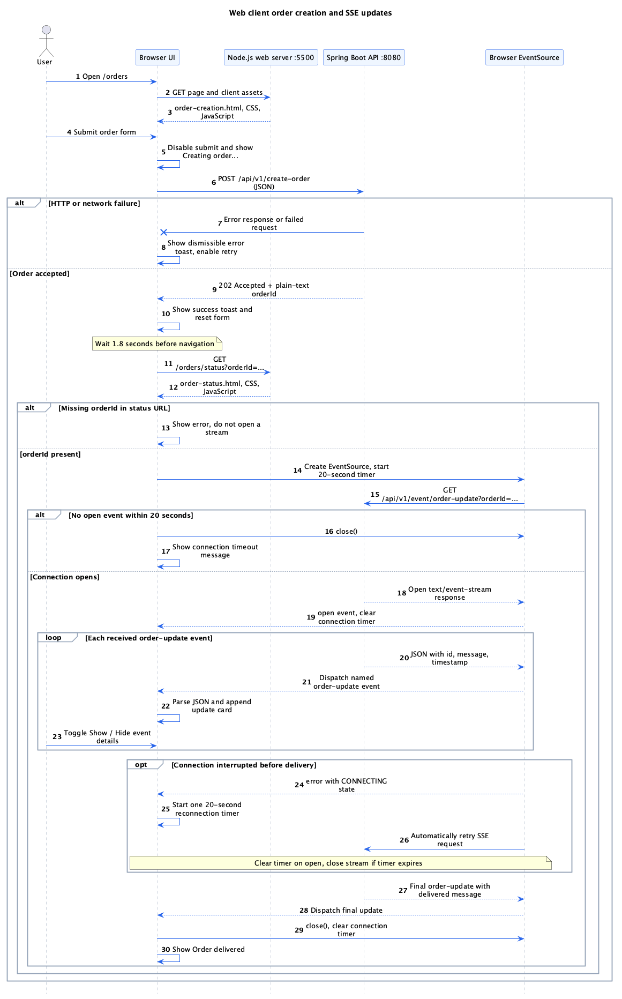
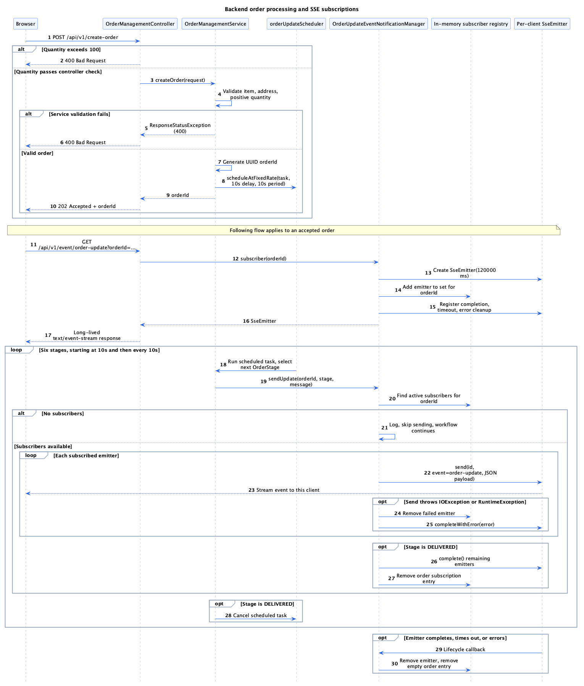
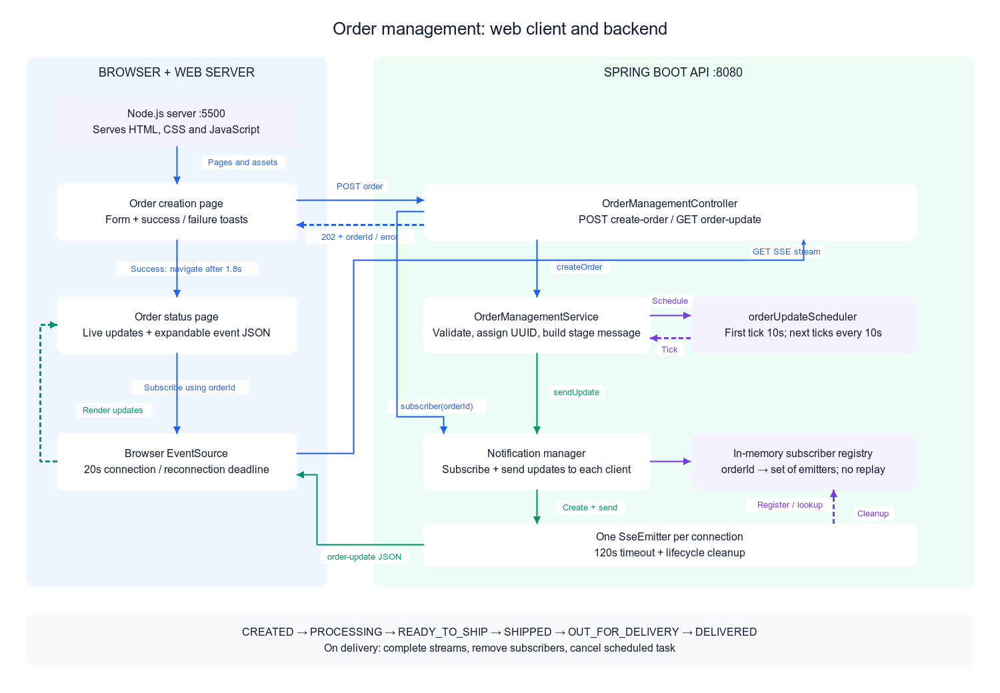
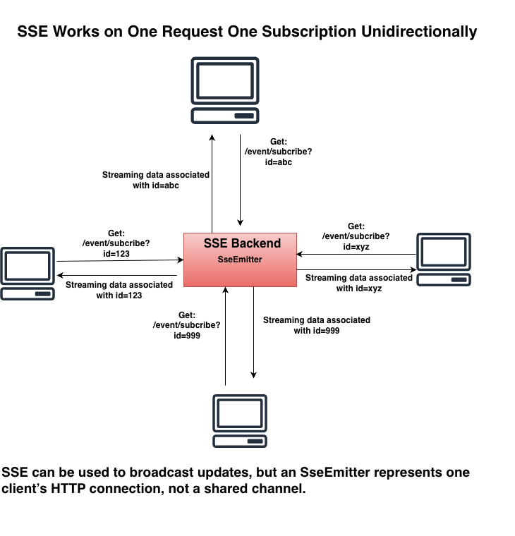

# Server-Sent Events (SSE): Practical Guide

This repository contains a Spring Boot SSE backend and a small Node.js app that
serves browser pages for exploring SSE and order updates.

## What is SSE?

**Server-Sent Events (SSE)** allow a server to stream updates to a client over a
long-lived HTTP response. SSE is **one-way**: server → client. In browsers, the
native `EventSource` API manages connections and automatic reconnection.

Common uses include AI response streaming, notifications, dashboards, job
progress, and order-status updates.

## How it works

1. Client opens an HTTP `GET` request to an SSE endpoint.
2. Server responds with `Content-Type: text/event-stream` and keeps the response open.
3. Server writes events as they occur; events are separated by blank lines.
4. Browser dispatches events to JavaScript listeners.
5. If the connection drops, `EventSource` generally reconnects automatically.

| Step | Browser (`EventSource`) | Spring Boot server |
|---|---|---|
| 1 | Sends `GET /api/stream` | |
| 2 | | Responds with `200 OK` and `Content-Type: text/event-stream` |
| 3 | | Sends events, for example `id: 101`, `event: notification`, and `data: ...` |
| 4 | Receives and dispatches each event | Keeps the HTTP response open for more events |

## Event format

```text
id: 101
event: order-update
data: {"orderId":"ORD123","status":"PROCESSING"}

id: 102
event: order-update
data: {"orderId":"ORD123","status":"SHIPPED"}

retry: 3000

```

| Field | Purpose |
|---|---|
| `id` | Event ID, which can be used for resuming after reconnect |
| `event` | Named event type |
| `data` | Payload (commonly JSON) |
| `retry` | Client reconnection delay in milliseconds |

A blank line terminates each event. Data may span multiple `data:` lines. The
browser can send `Last-Event-ID` when reconnecting; **the server needs to
implement event retention/replay** if missed events must be recovered.

## SSE vs WebSocket vs REST polling

| Feature | SSE | WebSocket | REST polling |
|---|---|---|---|
| Direction | Server → client | Bidirectional | Client asks repeatedly |
| Persistent stream | Yes | Yes | No, typically |
| Native browser reconnect | Yes (`EventSource`) | No | No |
| Best for | Notifications, dashboards, AI output | Chat, collaborative apps | Infrequent status checks |

## Spring Boot implementation (Spring MVC)

The example below publishes ten events, one every two seconds. For simplicity
it uses a shared scheduler. In production, manage the scheduler as a Spring bean
and track/limit active connections.

```java
import java.io.IOException;
import java.util.concurrent.*;
import java.util.concurrent.atomic.AtomicInteger;
import org.springframework.http.MediaType;
import org.springframework.web.bind.annotation.*;
import org.springframework.web.servlet.mvc.method.annotation.SseEmitter;

@RestController
@RequestMapping("/api")
public class EventController {
    private final ScheduledExecutorService scheduler =
        Executors.newScheduledThreadPool(2);

    @GetMapping(value = "/stream", produces = MediaType.TEXT_EVENT_STREAM_VALUE)
    public SseEmitter stream() {
        SseEmitter emitter = new SseEmitter(60_000L);
        AtomicInteger counter = new AtomicInteger();

        ScheduledFuture<?> job = scheduler.scheduleAtFixedRate(() -> {
            try {
                int id = counter.incrementAndGet();
                emitter.send(SseEmitter.event()
                    .id(String.valueOf(id))
                    .name("notification")
                    .data("Message " + id));
                if (id >= 10) {
                    emitter.complete();
                }
            } catch (IOException ex) {
                emitter.completeWithError(ex);
            }
        }, 0, 2, TimeUnit.SECONDS);

        emitter.onCompletion(() -> job.cancel(false));
        emitter.onTimeout(() -> job.cancel(false));
        emitter.onError(ex -> job.cancel(false));
        return emitter;
    }
}
```

> **Note:** This is an illustrative example. A robust implementation should
> avoid racing scheduled writes against stream completion, handle
> lifecycle/shutdown, and avoid blocking a small shared thread pool on slow
> clients.

## Browser client

```javascript
const source = new EventSource("http://localhost:8080/api/stream");

source.addEventListener("notification", (event) => {
  console.log("Event ID:", event.lastEventId);
  console.log("Payload:", event.data);
});

source.onerror = () => {
  console.warn("Stream interrupted; EventSource may reconnect");
};

// When the component/page no longer needs the connection:
// source.close();
```

If the frontend and backend use different origins, configure CORS correctly.
Native `EventSource` does not allow arbitrary custom request headers; for
cookie-based authentication consider `withCredentials` and appropriate
CORS/CSRF controls.

## Test the endpoint

```bash
curl -N -H 'Accept: text/event-stream' http://localhost:8080/api/stream
```

The `-N` option disables curl's output buffering so events appear as they arrive.

## Run the examples

Start the Spring Boot backend in one terminal:

```bash
cd sse-backend
./gradlew bootRun
```

Start the Node.js web client in another terminal:

```bash
cd sse-web-client
npm start
```

Open <http://localhost:5500>. The order creation page is available at
<http://localhost:5500/orders>. Once an order is created, the browser opens its
status page and subscribes to that order's SSE updates.

To inspect the basic notification stream directly:

```bash
curl -N -H 'Accept: text/event-stream' http://localhost:8080/api/stream
```

The stream sends ten named `notification` events, two seconds apart, with IDs
and JSON payloads, then closes.

## Order management subscription flow

The order management example uses a separate SSE endpoint for order-specific
updates:

### Web client sequence diagram

The Node.js server on port **5500** serves HTML, CSS, and JavaScript. The browser
calls the Spring Boot API on port **8080** directly.



[Editable PlantUML source](sse-backend/src/main/resources/diagrams/web-client-sequence.puml)

Malformed event JSON displays an error without closing the stream. The
connection timer measures time waiting for an `open` event, rather than time
waiting for the next order update. Repeated connection errors do not reset its
20-second deadline.

### Backend flow sequence diagram

Order processing runs independently of the browser subscription. Updates are
sent only to currently registered subscribers.



[Editable PlantUML source](sse-backend/src/main/resources/diagrams/backend-flow-sequence.puml)

| Approximate time after acceptance | Stage |
|---|---|
| 10 seconds | CREATED |
| 20 seconds | PROCESSING |
| 30 seconds | READY_TO_SHIP |
| 40 seconds | SHIPPED |
| 50 seconds | OUT_FOR_DELIVERY |
| 60 seconds | DELIVERED; stop scheduled task and complete active streams |

These times describe the scheduled simulation; execution can be delayed by
worker availability. A runtime failure in the scheduled task stops future
executions for that order.

### Block diagram



[Editable draw.io source](sse-backend/src/main/resources/diagrams/order-management-block.drawio) · [SVG export](sse-backend/src/main/resources/diagrams/order-management-block.svg)

Open the `.drawio` file in draw.io / diagrams.net to edit the components and
connectors. The PNG provides a static preview in Markdown. Expand the clickable
Mermaid version or component explanations below to explore the flow.

<details>
<summary><strong>Interactive Mermaid version</strong></summary>

Click components to open their source files in viewers that support Mermaid
links.

```mermaid
flowchart LR
    subgraph CLIENT["Browser"]
        FORM["Order creation page<br/>Form and success / error toasts"]
        STATUS["Order status page<br/>Live cards and expandable JSON"]
        SOURCE["EventSource<br/>20-second connection deadline"]
    end
    NODE["Node.js server :5500<br/>Serves pages and assets"]
    subgraph BACKEND["Spring Boot :8080"]
        API["OrderManagementController<br/>REST and SSE endpoints"]
        SERVICE["OrderManagementService<br/>Validation and stage messages"]
        SCHED["orderUpdateScheduler<br/>First tick 10s; period 10s"]
        MANAGER["Notification manager<br/>Send to order subscribers"]
        REGISTRY[("In-memory registry<br/>orderId to emitter set")]
        EMITTER["One SseEmitter per client<br/>120-second timeout"]
    end
    NODE -.->|HTML, CSS, JS| FORM
    NODE -.->|HTML, CSS, JS| STATUS
    FORM -->|POST create-order| API
    API -->|createOrder| SERVICE
    SERVICE -->|Schedule six stages| SCHED
    API -->|202 + orderId| FORM
    FORM -->|Success toast; navigate after 1.8s| STATUS
    STATUS -->|Subscribe using orderId| SOURCE
    SOURCE -->|GET event/order-update| API
    API -->|subscriber| MANAGER
    MANAGER -->|Register and look up| REGISTRY
    MANAGER -->|Create and send| EMITTER
    SCHED -->|Advance stage| SERVICE
    SERVICE -->|sendUpdate| MANAGER
    EMITTER ==>|Named order-update JSON| SOURCE
    SOURCE ==>|Render updates| STATUS
    EMITTER -.->|Completion, timeout, error cleanup| REGISTRY
    click FORM "sse-web-client/src/order-creation.js" "Open order creation logic"
    click STATUS "sse-web-client/src/order-status.js" "Open order status logic"
    click SOURCE "sse-web-client/src/order-status.js" "Open connection timeout logic"
    click NODE "sse-web-client/server.js" "Open page and asset routing"
    click API "sse-backend/src/main/java/com/sc/demo/sse/examples/ordermanagement/OrderManagementController.java" "Open REST and SSE endpoints"
    click SERVICE "sse-backend/src/main/java/com/sc/demo/sse/examples/ordermanagement/OrderManagementService.java" "Open order workflow"
    click SCHED "sse-backend/src/main/java/com/sc/demo/sse/SseConfiguration.java" "Open scheduler configuration"
    click MANAGER "sse-backend/src/main/java/com/sc/demo/sse/examples/ordermanagement/OrderUpdateEventNotificationManager.java" "Open subscriber management"
    click REGISTRY "sse-backend/src/main/java/com/sc/demo/sse/examples/ordermanagement/OrderUpdateEventNotificationManager.java" "Open in-memory registry"
    click EMITTER "sse-backend/src/main/java/com/sc/demo/sse/examples/ordermanagement/OrderUpdateEventNotificationManager.java" "Open emitter lifecycle"
    classDef client fill:#eff6ff,stroke:#2563eb,color:#172554
    classDef backend fill:#ecfdf5,stroke:#059669,color:#064e3b
    classDef infrastructure fill:#f5f3ff,stroke:#7c3aed,color:#4c1d95
    class FORM,STATUS,SOURCE client
    class API,SERVICE,MANAGER backend
    class NODE,SCHED,REGISTRY,EMITTER infrastructure
```




</details>

<details>
<summary><strong>1. Create an order: request and toast path</strong></summary>

[Order creation JavaScript](sse-web-client/src/order-creation.js) disables the
submit button and posts the form directly to the backend. The
[controller](sse-backend/src/main/java/com/sc/demo/sse/examples/ordermanagement/OrderManagementController.java)
returns an order ID after the service schedules processing. Success displays a
green toast and navigates after 1.8 seconds; failure displays a dismissible red
toast and enables retry. The Node.js server only serves frontend files.

</details>

<details>
<summary><strong>2. Subscribe and receive updates: streaming path</strong></summary>

[Order status JavaScript](sse-web-client/src/order-status.js) reads the order ID
from the URL and creates an EventSource. The
[notification manager](sse-backend/src/main/java/com/sc/demo/sse/examples/ordermanagement/OrderUpdateEventNotificationManager.java)
registers one emitter per connection under that ID. Each scheduled stage sends
an event to every active subscriber for that order. The browser displays the
message and timestamp; its details button expands the JSON payload.

</details>

<details>
<summary><strong>3. Connection failure and delivery: closing path</strong></summary>

The browser closes its EventSource if the initial connection or a reconnection
attempt does not open within 20 seconds. A successful open cancels that timer.
After receiving a message containing `delivered`, the browser closes the
connection. The backend also completes active emitters after DELIVERED, removes
subscriptions, and cancels the order's scheduled task. Completion, timeout,
and error callbacks clean up individual emitters.

</details>

<details>
<summary><strong>4. Memory and timing: what the diagram implies</strong></summary>

The registry contains connections, not stored order history. Processing starts
when the order is accepted, independently of subscription. Updates with no
subscriber are skipped, and missed updates are not replayed. Subscribing does
not validate whether the order exists or has already completed. The browser's
20-second connection deadline and the emitter's 120-second timeout are separate
limits.

</details>

1. The client submits an order with `POST /api/v1/create-order`. The JSON body
   contains `itemName`, numeric `quantity`, and `address`. The backend responds
   with HTTP `202 Accepted` and the new order ID as plain text.
2. The web client navigates to `/orders/status?orderId=<order-id>`.
3. The status page opens an `EventSource` connection to
   `GET /api/v1/event/order-update?orderId=<order-id>`.
4. The controller returns an `SseEmitter`. The notification manager registers
   that connection under the order ID.
5. As the order progresses, the service publishes updates. The manager sends
   each update to every emitter currently subscribed to that order. Events use
   the name `order-update` and contain JSON with `id`, `message`, and
   `timestamp` fields.
6. After the `DELIVERED` update, the server completes the subscribers'
   emitters. Emitters are also removed when a connection completes, times out,
   or encounters an error.

The order status page listens specifically for the `order-update` event and
shows each update as it arrives. Use the **Show event details** button to view
the event's JSON payload. The browser's `EventSource` reconnects automatically
after a temporary interruption, with a 20-second deadline for opening each
connection or reconnection; the in-memory manager does not retain or replay
updates missed while disconnected.

The manager keeps subscriber connections in this application's memory. It
supports multiple subscribers for the same order on this server instance; for
multiple backend instances, publish order updates through a shared broker so
each instance can notify its own connected clients.

### Generic Spring MVC subscription example

An `SseEmitter` represents one HTTP client connection. Keep a collection of
emitters for each topic (such as an order ID), register cleanup callbacks, and
send each published event to that topic's current subscribers:

```java
private final Map<String, Set<SseEmitter>> subscribers = new ConcurrentHashMap<>();

public SseEmitter subscribe(String topic) {
    SseEmitter emitter = new SseEmitter(120_000L);
    Set<SseEmitter> topicSubscribers =
        subscribers.computeIfAbsent(topic, key -> ConcurrentHashMap.newKeySet());
    topicSubscribers.add(emitter);

    Runnable removeSubscriber = () -> {
        topicSubscribers.remove(emitter);
        if (topicSubscribers.isEmpty()) {
            subscribers.remove(topic, topicSubscribers);
        }
    };
    emitter.onCompletion(removeSubscriber);
    emitter.onTimeout(removeSubscriber);
    emitter.onError(error -> removeSubscriber.run());
    return emitter;
}

public void publish(String topic, Object payload) {
    Set<SseEmitter> topicSubscribers = subscribers.get(topic);
    if (topicSubscribers == null) {
        return;
    }

    for (SseEmitter emitter : topicSubscribers) {
        try {
            emitter.send(SseEmitter.event()
                .name("update")
                .data(payload));
        } catch (IOException | IllegalStateException error) {
            topicSubscribers.remove(emitter);
            emitter.completeWithError(error);
        }
    }
}
```



The browser subscribes to the endpoint and listens for the matching event name:

```javascript
const orderId = "order-id-from-create-response";
const url = new URL("http://localhost:8080/api/v1/event/order-update");
url.searchParams.set("orderId", orderId);

const source = new EventSource(url);
source.addEventListener("order-update", (event) => {
  const update = JSON.parse(event.data);
  console.log(update.message, update.timestamp);
});
source.onerror = () => console.warn("SSE connection interrupted; retrying");
```

These snippets are generic examples of per-topic fan-out. The application code
uses `orderId` as the topic and sends the `order-update` event. In a real
application, validate/authorize subscriptions and consider thread-safe
concurrent removal, bounded connection lifetimes, heartbeats, and broker-based
fan-out when running multiple server instances.

## Scaling to multiple instances

| Component | Responsibility |
|---|---|
| Browsers | Open SSE connections |
| Load balancer / ingress | Routes connections to an SSE service instance |
| SSE service instances | Forward relevant events to clients connected to that instance |
| Kafka / Redis Streams | Distributes application events to the SSE service instances |

Publish application events into a broker or durable stream; each SSE service
instance forwards relevant events to the clients connected to it. A replay
store and stable event IDs help recover events after reconnect. A broker does
not by itself guarantee replay to the correct client.

### Production checklist

- [ ] Send periodic heartbeat comments (`: heartbeat`) to prevent idle proxy timeouts.
- [ ] Disable reverse-proxy buffering and configure appropriate timeouts.
- [ ] Enforce authentication and event-level authorization.
- [ ] Bound active connections, buffering, and per-client outbound queues.
- [ ] Handle slow consumers and cancellations gracefully.
- [ ] Use stable event IDs and replay if delivery continuity matters.
- [ ] Design for duplicates and idempotent client processing.
- [ ] Monitor concurrent connections, disconnections, lag, and error rate.
- [ ] Test behavior during deployments, pod restarts, and network interruptions.
- [ ] Evaluate HTTP/2 and browser connection limits for your deployment.

## Interview questions

1. How does SSE differ from WebSockets and HTTP long polling?
2. How does `Last-Event-ID` work? Does SSE guarantee delivery?
3. How would you support 100,000 concurrent streaming connections?
4. How would you implement replay across Kubernetes pods?
5. What happens if a client is slower than the event producer?
6. When would you use Spring WebFlux `Flux<ServerSentEvent<T>>` instead of Spring MVC `SseEmitter`?
7. How do proxy buffering, HTTP timeouts, and heartbeats affect SSE?
8. How would you handle authentication when `EventSource` cannot set custom headers?

## References

- [MDN: Using server-sent events](https://developer.mozilla.org/en-US/docs/Web/API/Server-sent_events/Using_server-sent_events)
- [WHATWG HTML Living Standard: Server-sent events](https://html.spec.whatwg.org/multipage/server-sent-events.html)
- [Spring Framework: `SseEmitter`](https://docs.spring.io/spring-framework/docs/current/javadoc-api/org/springframework/web/servlet/mvc/method/annotation/SseEmitter.html)
